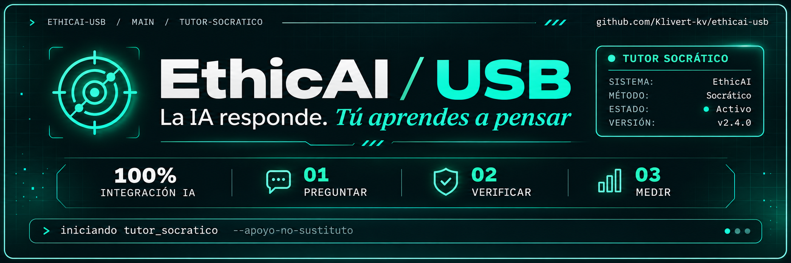
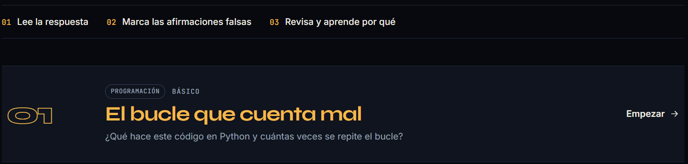
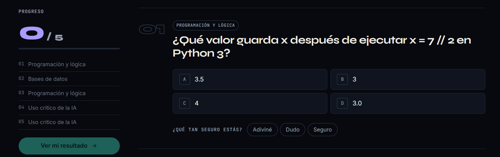

<p align="center">
  
</p>

<p align="center">
  <b>Español</b> | <a href="README_en.md">English</a>
</p>

<p align="center">
  
  
  
  
  
</p>

<p align="center"><b>La IA responde. Tú aprendes a pensar.</b></p>

---

## ¿Qué es EthicAI USB?

Hoy cualquier estudiante puede pedirle a una IA que le haga la tarea. El problema no es la IA: es usarla para copiar en lugar de aprender.

**EthicAI USB** es una plataforma web que enseña a usar la inteligencia artificial de forma crítica y honesta. No castiga el uso de la IA ni busca "pillar" a nadie: entrena al estudiante para dudar de lo que la IA dice, pensar antes de preguntar y reconocer qué sabe de verdad.

> Proyecto Final de Diseño · Facultad de Ingenierías y Ciencias Básicas · Universidad Simón Bolívar, Cúcuta. Prototipo académico, no es una plataforma oficial de la universidad.

## Las tres herramientas

### 1. Atrapa la alucinación

La IA a veces inventa datos con total seguridad. Aquí el estudiante lee respuestas "de IA" que esconden errores, marca las frases falsas y descubre por qué lo son. Funciona sin internet.

<p align="center">
  
</p>

### 2. Tutor socrático

Un chat que **no entrega la respuesta**. Guía con preguntas y pistas cada vez más concretas para que el estudiante llegue solo a la solución.

### 3. Autodiagnóstico

Cinco preguntas en las que el estudiante también dice qué tan seguro está. Al final ve qué temas domina, qué debe repasar y si confía de más en lo que cree saber. Funciona sin internet.

<p align="center">
  
</p>

## Hacia dónde va: educación donde no llega internet

En muchas zonas rurales de Colombia no hay buena conexión, y con ella tampoco llegan muchas de las herramientas que hoy ayudan a aprender.

Dos de las tres herramientas ya funcionan sin internet. El siguiente paso es que el tutor también lo haga, usando **modelos de IA pequeños instalados en el propio computador** de la escuela. Así, un solo equipo podría llevar un tutor que enseña a pensar a lugares donde hoy no llegan ni los conceptos ni la conexión.

## Cómo probarlo

Necesitas **Windows 10/11**, **Node.js 20 o superior** (<https://nodejs.org>) y una **clave gratuita de Groq** (<https://console.groq.com/keys>, no pide tarjeta).

```powershell
copy .env.example .env      # luego pega tu clave en LLM_API_KEY
npm install
npm run build
npm start
```

Abre **<http://localhost:3001>**.

<details>
<summary>Más detalles (comprobar el modelo, modo desarrollo, pruebas)</summary>

- `npm run check:ollama` comprueba la conexión con el modelo. Debe terminar en «Integración correcta».
- `npm run dev` abre el modo desarrollo en <http://localhost:5173>.
- `npm test` corre las pruebas automáticas (no necesitan internet ni la clave).
- `npm run eval:tutor` prueba el comportamiento del tutor con el modelo real.

| Problema | Solución |
| --- | --- |
| "Revisa LLM_API_KEY" | La clave falta o está mal copiada en el `.env`. |
| "Se agotó la cuota" | Límite del plan gratuito; espera unos minutos. |
| Puerto 3001 ocupado | Cambia `PORT` en el `.env` o cierra el otro programa. |

</details>

## Privacidad

- No hay cuentas ni registro, y no se guarda nada en un servidor.
- El laboratorio y el autodiagnóstico corren solo en tu navegador.
- Los mensajes del tutor se envían a un modelo en la nube para poder responder; la interfaz lo avisa.

## Equipo

| Integrante | Rol |
| --- | --- |
| Klivert Chiquiza | Líder · gestión y cierre |
| Nilson Hernández | Análisis y pruebas |
| Manuel Pinilla | Base técnica y tutor |
| Camilo Anaya | Autodiagnóstico y experiencia de usuario |

<p align="center"><i>No somos un detector de plagio. No castigamos el uso de la IA: enseñamos a usarla bien.</i></p>
