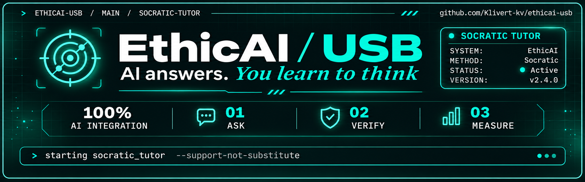
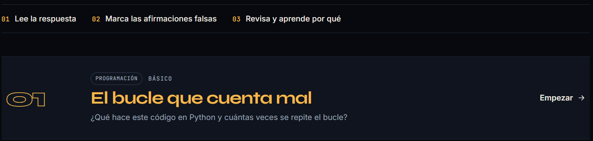
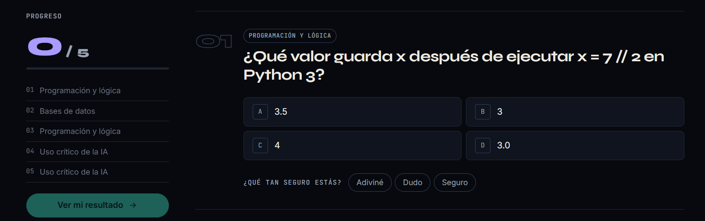

<p align="center">
  
</p>

<p align="center">
  <a href="README.md">Español</a> | <b>English</b>
</p>

<p align="center">
  
  
  
  
  
</p>

<p align="center"><b>AI gives answers. You learn to think.</b></p>

---

## What is EthicAI USB?

Today any student can ask an AI to do their homework. The problem isn't the AI: it's using it to copy instead of to learn.

**EthicAI USB** is a web platform that teaches students to use artificial intelligence critically and honestly. It doesn't punish AI use or try to "catch" anyone: it trains students to question what the AI says, think before they ask, and recognize what they really know.

> Final Design Project · Faculty of Engineering and Basic Sciences · Universidad Simón Bolívar, Cúcuta, Colombia. Academic prototype, not an official university platform.

## The three tools

### 1. Catch the hallucination

AI sometimes makes things up with total confidence. Here students read "AI" answers that hide mistakes, mark the false sentences and find out why they're wrong. Works offline.

<p align="center">
  
</p>

### 2. Socratic tutor

A chat that **doesn't hand over the answer**. It guides with questions and increasingly specific hints so students reach the solution on their own.

### 3. Self-assessment

Five questions where students also say how sure they are. At the end they see which topics they master, what to review, and whether they're overconfident about what they think they know. Works offline.

<p align="center">
  
</p>

## Where it's heading: education where the internet doesn't reach

Many rural areas in Colombia have poor or no connectivity, and with it, many of today's learning tools never arrive.

Two of the three tools already work offline. The next step is to make the tutor work offline too, using **small AI models installed on the school's own computer**. A single machine could then bring a tutor that teaches students to think to places where neither the concepts nor the connection reach today.

## Try it

You need **Windows 10/11**, **Node.js 20 or later** (<https://nodejs.org>) and a **free Groq key** (<https://console.groq.com/keys>, no card required).

```powershell
copy .env.example .env      # then paste your key into LLM_API_KEY
npm install
npm run build
npm start
```

Open **<http://localhost:3001>**.

<details>
<summary>More details (model check, dev mode, tests)</summary>

- `npm run check:ollama` checks the connection to the model. It should end with "Integración correcta".
- `npm run dev` starts dev mode at <http://localhost:5173>.
- `npm test` runs the automated tests (no internet or key needed).
- `npm run eval:tutor` tests the tutor's behavior with the real model.

| Problem | Fix |
| --- | --- |
| "Revisa LLM_API_KEY" | The key is missing or wrongly pasted in `.env`. |
| "Se agotó la cuota" | Free plan limit; wait a few minutes. |
| Port 3001 in use | Change `PORT` in `.env` or close the other program. |

</details>

## Privacy

- No accounts or sign-up, and nothing is stored on a server.
- The lab and the self-assessment run only in your browser.
- Tutor messages are sent to a cloud model so it can reply; the interface says so.

## Team

| Member | Role |
| --- | --- |
| Klivert Chiquiza | Lead · management and delivery |
| Nilson Hernández | Analysis and testing |
| Manuel Pinilla | Technical base and tutor |
| Camilo Anaya | Self-assessment and user experience |

<p align="center"><i>We're not a plagiarism detector. We don't punish AI use: we teach how to use it well.</i></p>
